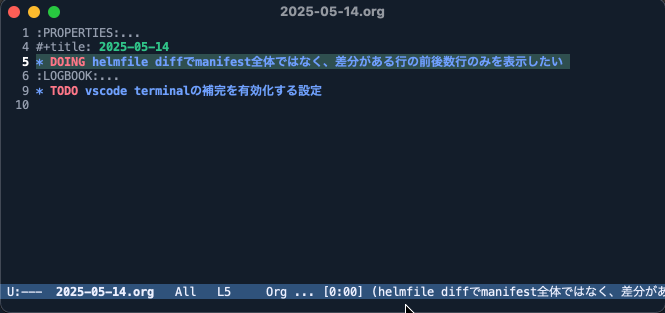
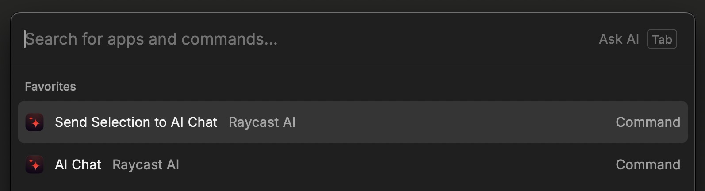
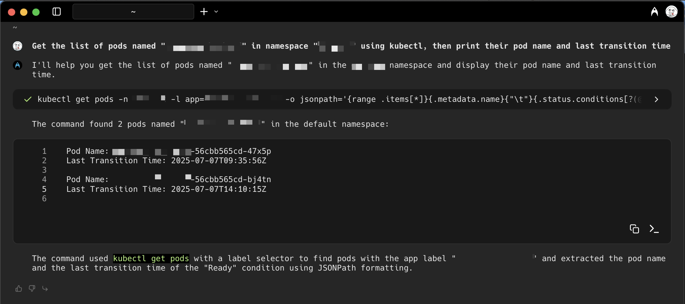

:PROPERTIES:
:ID:       FE4668E0-793D-4F33-9B48-40B4586AF58B
:END:
#+title: AIを前提としたmacOS/iOSアプリ選定
#+DATE: 2025-07-08 00:01
#+TAGS: AI tool
#+IMAGE: /images/app-choices-with-ai/og.png

macOS/iOSのアプリは好きで定期的に使うものを変えてみたりしているが、最近は特にAIの存在を意識してアプリ選びをするようになってきたのでそれをまとめる。

どれも決定版という感じではなく、日々試行錯誤しながら使っている現段階での記録になる。なお各種AI Chatクライアントなどは割愛する。

* ブラウザ：Microsoft Edge
元々Safariを利用していたがApple Intelligenceによる要約機能がかなりイマイチなため、サイドバーからCopilotを呼び出せるEdgeに移行した。ページ要約のクオリティはもちろん対話ベースで質問を深掘りもできるし、YouTube動画も要約できたりと満足感が高い。macOS/iOSともに日常で必須のものになっている。

先日発表された [[https://www.diabrowser.com/][Dia Browser]] も同様の使い方ができるので試してるが、現時点では若干動作が重かったりでEdgeの置き換えには至っていない。

* ドキュメント/TODO管理：Emacs (org-mode)
[[https://horimisli.me/entry/journaling-2023/][タスク管理や作業メモを書く場所を Emacs (org-mode) に移行した]] を書いて以降、org-modeでドキュメントを書いたり日々のTODOを管理してる。AIインテグレーションのしやすさでもEmacsのメリットが大きく使い続けている。

例えば [[https://github.com/karthink/gptel][karthink/gptel]] を使って書いているドキュメント・タスクを書きながらその場でAIに質問し、回答を挿入できるようにしている。特に技術調査・学習時に便利で、理解できてない疑問点をdoc上に書き出す→その場でgptelに回答を書き込んでもらう→その内容を整形する...を反復してる内にドキュメントが出来上がるのが便利で使ってる。

他にもコードを書く用途でも使っており、vtermでClaude Codeを操作しつつ簡単な手直しを別bufferで、という感じ。この辺は詳しく語り始めると1記事になりそうなので詳細は省いておく。

* 手書きノート：Goodnotes
上記のEmacsでのドキュメントと合わせて手書きでの思考整理も毎日やっていて、それには [[https://www.goodnotes.com/][Goodnotes]] を使っている。一時期Apple純正メモを使っていたが書き心地や将来的なAIインテグレーションへの期待感から移行した。

まだ具体的に活用できてはないが、Goodnotesのノートバックアップ機能をAI用途に使えることを期待してる。これはGoogle Driveなど好きなストレージサービスにノートをPDFで保存してくれるもので、つまり手書きのデータをファイル形式で扱えるため好きなツールに読ませられる。

Goodnotes内におけるAI機能は既に [[https://www.goodnotes.com/blog/ask-goodnotes][Ask Goodnotes]] があるが、これは自分のユースケースに合った使い方が思いつかず活用できていない。[[https://www.goodnotes.com/jp/beta?gn_id=770bfc49-8267-4e5e-8197-7ef1b9bac0f2][Goodnotesベータ版]] ではGoodnotes AIが予告されていたりアプリ内機能も充実してきそうなのでそちらも期待したい。

* ブックマーク：Instapaper
長らくブラウザブックマークを使っていたが、数年ぶりに記事の保存先にInstapaperを使い始めた。Goodnotesと同じく将来的にAIの恩恵を受けられることを見込んで使い始めてる。

InstapaperはPremium加入するとページのフルアーカイブを保存してくれるので、記事の保管庫として利用してMCPからアクセス可能になったりするとだいぶ嬉しいなとか思っている。先日は競合に当たるPocketのサービス終了というニュースもあったが、Instapaperは地味に機能やクライアントのアップデートが継続的に行われてるので今後にも期待したいところ。

実際AI関連でもすでにGPTをバックエンドにした記事の要約機能が組み込まれている。ただこれは正直かなり微妙で要約したい場合はEdgeで開いてCopilotにかけている（SafariのApple Intelligenceに近いイメージで、サマリが短すぎる...）。

[[https://bthdonohue.com/2024/04/24/multilevel-summarization-instapaper.html][Multi-Level Summarization in Instapaper]]

* ランチャー：Raycast

Raycastは以前に[[https://horimisli.me/entry/raycast-pagerduty/][拡張機能を書いてみたり]]してからそこそこ長く使い続けている。Raycastの入力バーから直接AI Chatを開始できる機能だったり、別アプリ上の選択範囲をRaycast経由でAIに質問できる機能をよく使ってる。

他にもチャットUIの対話でカレンダーに予定を入れられるのも重宝してる。これmacOSがやるべきじゃない・・・？みたいなことをRaycastが代行してくれている。

Raycast AIは有料プランでないとモデル選択や利用回数に制限がかかるが、先日自前のAPI Keyを登録すればClaude 4等も自由に使えるようになったので一旦free planのまま使ってる。

[[https://www.raycast.com/changelog/1-100-0][Raycast v1.100.0 - Bring Your Own Key]]

* ターミナル：Warp
ターミナル内からAgentを呼び出してコードを生成したりコマンド操作を自動で行ったりできる。コーディングに関してはClaude Codeが組み込まれているようなイメージに近い。

今のところ開発用途ではClaude Codeを起動したりVSCode Copilotを使う頻度が多く、Warpではシェル芸が必要な場面を自然言語で解決するような使い方にとどまっている。Ver2.0では複数Agentを並列で動かす際に便利な機能も組み込まれているのでもうちょっと活用の範囲を広げてみたい。

[[https://www.warp.dev/blog/reimagining-coding-agentic-development-environment][Warp: Introducing Warp 2.0: the Agentic Development Environment]]

* まとめ
現時点でAI機能を活用してたり、将来的に恩恵が得られそうで使ってみてるアプリをまとめた。

正直そんなに新進気鋭のものをいろいろ試している感じではない。いまいち役割の棲み分けがはっきりしないものをあれこれサブスクする気が起きないのと、データプライバシーなどの規約を追いながら使いこなすのがだるいな、という点からつい保守的な利用に留まっている気がする。

とはいえ今は斜に構えず身銭を切ったりリスクをきちんと見極めて積極的に取っていくべき世のフェーズかなとは認識していて、引き続き試行錯誤を続けていきたい。

